# Markdown 语法样例大全

> 本文档汇总了 Markdown 的常用与进阶语法，包含公式、图形、Mermaid 图示，以及 GitHub 风格提示块、定义列表、折叠内容等扩展场景。
> 可用于测试各编辑器 Markdown 支持程度

---

## 目录

- [一、标题 Headers](#一标题-headers)
- [二、文本样式 Text Styles](#二文本样式-text-styles)
- [三、段落与换行](#三段落与换行)
- [四、引用 Blockquote](#四引用-blockquote)
- [五、列表 Lists](#五列表-lists)
- [六、代码 Code](#六代码-code)
- [七、链接与图片 Links & Images](#七链接与图片-links--images)
- [八、表格 Table](#八表格-table)
- [九、分隔线 Horizontal Rule](#九分隔线-horizontal-rule)
- [十、脚注 Footnotes](#十脚注-footnotes)
- [十一、任务列表 Task List](#十一任务列表-task-list)
- [十二、定义列表 Definition List](#十二定义列表-definition-list)
- [十三、GitHub 风格提示块 Alerts](#十三github-风格提示块-alerts)
- [十四、折叠内容 Details](#十四折叠内容-details)
- [十五、注释与转义 Comments & Escaping](#十五注释与转义-comments--escaping)
- [十六、Emoji 与特殊字符](#十六emoji-与特殊字符)
- [十七、内嵌 HTML 与富文本](#十七内嵌-html-与富文本)
- [十八、锚点与目录跳转](#十八锚点与目录跳转)
- [十九、YAML Front Matter](#十九yaml-front-matter)
- [二十、数学公式 Math (LaTeX)](#二十数学公式-math-latex)
- [二十一、图形 Graphics](#二十一图形-graphics)
- [二十二、Mermaid 图表](#二十二mermaid-图表)
- [二十三、扩展图表（Mermaid 进阶）](#二十三扩展图表mermaid-进阶)
- [二十四、兼容性与工具对照](#二十四兼容性与工具对照)

---

## 一、标题 Headers

Markdown 支持 1~6 级标题，`#` 数量代表层级。

```markdown
# 一级标题 H1
## 二级标题 H2
### 三级标题 H3
#### 四级标题 H4
##### 五级标题 H5
###### 六级标题 H6
```

# 一级标题 H1

## 二级标题 H2

### 三级标题 H3

#### 四级标题 H4

##### 五级标题 H5

###### 六级标题 H6

> **Setext 风格标题（部分渲染器支持）**：用 `===` 表示 H1、`---` 表示 H2。
>
> ```markdown
> 大标题
> ===
> 小标题
> ---
> ```

---

## 二、文本样式 Text Styles

### 标准样式

| 样式 | 写法 | 效果 |
| --- | --- | --- |
| 加粗 | `**加粗**` | **加粗** |
| 斜体 | `*斜体*` | *斜体* |
| 加粗斜体 | `***加粗斜体***` | ***加粗斜体*** |
| 删除线 | `~~删除线~~` | ~~删除线~~ |
| 行内代码 | `` `code` `` | `code` |
| 下划线 | `<u>下划线</u>` | <u>下划线</u> |
| 高亮 | `==高亮==` | ==高亮== |
| 上标 | `X<sup>2</sup>` | X<sup>2</sup> |
| 下标 | `H<sub>2</sub>O` | H<sub>2</sub>O |

还可以使用 HTML 实体：`&copy;` &copy;  `&amp;` &amp;  `&lt;` &lt;  `&times;` &times;  `&hearts;` &hearts;

### 更多文本修饰（依赖 HTML / 特定渲染器）

- 小号字：<small>这是 small 小号字</small> — 写法 `<small>...</small>`
- 标记高亮：<mark>这是 mark 高亮</mark> — 写法 `<mark>...</mark>`
- 缩写提示：<abbr title="HyperText Markup Language">HTML</abbr> — 写法 `<abbr title="...">HTML</abbr>`
- 注音（Ruby）：<ruby>汉字<rt>hàn zì</rt></ruby> — 写法 `<ruby>汉字<rt>hàn zì</rt></ruby>`
- 键盘按键：按 <kbd>Ctrl</kbd> + <kbd>C</kbd> 复制 — 写法 `<kbd>Ctrl</kbd>`
- 行内颜色：<span style="color:#e63946">红色文字</span> — 写法 `<span style="color:#e63946">红色文字</span>`
- 文本居中（依赖 HTML）：<div align="center">这是居中文本</div> — 写法 `<div align="center">...</div>`

---

## 三、段落与换行

段落之间用空行分隔。

这是第一段。

这是第二段（中间空了一行）。

行尾加两个空格  
可以实现硬换行（此行末尾有两个空格）。

反斜杠换行（部分渲染器支持）：\
这一行通过行尾反斜杠换行。

---

## 四、引用 Blockquote

> 这是一级引用。
>
> > 这是嵌套引用（二级）。
> >
> > > 三级引用。
>
> 回到一级引用，可以包含其他元素，例如 **加粗**、`代码`、[链接](#) 或列表：
>
> - 引用内列表项一
> - 引用内列表项二

带前导 `>` 的连续文本会被合并为一个引用块。引用也可以只有一行：`> 单行引用`。

---

## 五、列表 Lists

### 无序列表

- 项目一
- 项目二
  - 子项目 A
  - 子项目 B
    - 子子项目 i
- 项目三

也可以使用 `+` 或 `-` 作为标记：

+ 用加号
- 用减号
* 用星号

### 有序列表

1. 第一步
2. 第二步
   1. 第二步的子步骤
   2. 第二步的另一个子步骤
3. 第三步

> 有序列表的数字可以是任意值，渲染器会按出现顺序自动重排（写成 `1.` `1.` `1.` 也能正常显示）。

### 混合与段落列表

1. 第一项包含多段内容：

   这是该列表项的第二段，缩进对齐即可。

2. 第二项含有代码块：

   ```text
   缩进 4 个空格即可在列表项内嵌入代码块
   ```

---

## 六、代码 Code

### 行内代码

使用 `print("Hello, Markdown!")` 可以输出文本。反引号内部可直接写反引号：`` ` `` 或 `` `code` ``。

### 缩进代码块（无语言标注）

    这是缩进四个空格形成的代码块，不带语法高亮。
    for i in range(3):
        print(i)

### 代码块（带语法高亮）

```python
def fibonacci(n):
    """返回前 n 个斐波那契数"""
    a, b = 0, 1
    result = []
    for _ in range(n):
        result.append(a)
        a, b = b, a + b
    return result

print(fibonacci(10))
```

```javascript
// JavaScript 示例
const items = [1, 2, 3, 4, 5];
const doubled = items.map(x => x * 2);
console.log(doubled);
```

```sql
SELECT id, name, age
FROM users
WHERE age > 18
ORDER BY age DESC;
```

```bash
# Shell 示例
echo "Hello World"
ls -la ~/Documents
```

### 代码块标题与高亮某行（部分渲染器支持）

```python {title="示例.py" hl_lines=["2-3"]}
import math          # 第 1 行
def area(r):         # 第 2 行（高亮）
    return math.pi * r ** 2   # 第 3 行（高亮）
print(area(2))       # 第 4 行
```

---

## 七、链接与图片 Links & Images

### 链接

- 行内链接：[mdput 官网](https://www.mdput.com)
- 带标题链接：[悬停看提示](https://www.mdput.com "这是标题")
- 引用式链接：[参考式][ref-id]
- 邮箱链接：[发送邮件](mailto:douya@139.com)
- 相对链接：[返回顶部](#markdown-语法样例大全)
- 自动链接：<https://www.mdput.com>
- 自动邮件链接：<douya@139.com>

[ref-id]: https://www.mdput.com "引用定义"

### 图片

行内图片语法：``
> 提示：本地图片使用相对路径，如 ``。
> 下方为本地相对路径写法示例（路径不存在时仅作语法演示，渲染为裂图）：
> ``

### 图片链接（点击图片跳转）

[](https://www.mdput.com)

### 带尺寸的图片（HTML）


---

## 八、表格 Table

### 基本表格

| 姓名 | 年龄 | 城市 |
| --- | --- | --- |
| 张三 | 28 | 北京 |
| 李四 | 32 | 上海 |
| 王五 | 25 | 深圳 |

### 对齐方式

| 左对齐 | 居中对齐 | 右对齐 |
| :--- | :---: | ---: |
| 文本 | 文本 | 文本 |
| A | B | C |

### 单元格内嵌

| 功能 | 说明 | 状态 |
| --- | --- | --- |
| 登录 | 支持手机号 / 邮箱 | ✅ 完成 |
| 支付 | 接入微信 / 支付宝 | ⏳ 进行中 |
| 导出 | 支持 PDF / Excel | ❌ 未开始 |

### 单元格内嵌套其他元素

| 类型 | 示例 | 备注 |
| --- | --- | --- |
| 代码 | `npm install` | 行内代码 |
| 链接 | [文档](https://www.mdput.com) | 行内链接 |
| 强调 | **重点** / *次要点* | 加粗斜体 |

### HTML 表格（支持合并单元格，标准 Markdown 表格做不到）

<table>
  <tr>
    <th rowspan="2">姓名</th>
    <th colspan="2">成绩</th>
  </tr>
  <tr>
    <th>数学</th>
    <th>语文</th>
  </tr>
  <tr>
    <td>小明</td>
    <td>95</td>
    <td>88</td>
  </tr>
</table>

---

## 九、分隔线 Horizontal Rule

使用三个或以上的 `*`、`-` 或 `_`（需单独成行，且前后建议留空行避免被当作标题下划线）：

---

***

___

---

## 十、脚注 Footnotes

这里有一个脚注示例。[^1]

另一个带内容的脚注。[^note]

[^1]: 这是第一个脚注的内容。
[^note]: 这是第二个脚注，可写多行内容。
    第二行会延续到同一个脚注内（缩进对齐即可）。

> 脚注编号与定义顺序通常无关，按出现顺序自动编号；多数渲染器支持点击跳回正文。

---

## 十一、任务列表 Task List

- [x] 撰写文档大纲
- [x] 收集语法示例
- [ ] 补充 Mermaid 图表
- [ ] 校对流式渲染兼容性
  - [ ] 流程图
  - [ ] 时序图
  - [x] 饼图

> 注意：任务列表在 GitHub、WorkBuddy 等平台可交互勾选；纯静态渲染器只显示只读方框。

---

## 十二、定义列表 Definition List

> 描述列表（术语 + 解释），GitHub 与多数渲染器已支持 `术语` + `: 解释` 写法。

```markdown
Markdown
: 一种轻量级标记语言。

LaTeX
: 用于排版科技文档的排版系统。
```

实际渲染效果：

Markdown
: 一种轻量级标记语言，由 John Gruber 于 2004 年创建。

LaTeX
: 用于排版科技文档、尤其是含复杂公式的排版系统。

CommonMark
: 旨在统一各 Markdown 实现的规范标准。

---

## 十三、GitHub 风格提示块 Alerts

> GitHub、WorkBuddy 等支持以下五种警示块（以 `> [!NOTE]` 等开头）。

> [!NOTE]
> 这是普通提示，用于补充背景信息。

> [!TIP]
> 这是建议/技巧，帮助读者更好地完成任务。

> [!IMPORTANT]
> 这是重要信息，读者必须了解以达成目标。

> [!WARNING]
> 这是警告，需要立即注意以避免问题。

> [!CAUTION]
> 这是危险提示，操作可能存在风险。

---

## 十四、折叠内容 Details

> 利用 HTML 的 `<details>` 实现可折叠区块（GitHub、WorkBuddy 支持）。

<details>
  <summary>点击展开：更多说明</summary>

这里是被折叠的内容，可以放任意 Markdown，例如：

- 列表项
- 代码：

  ```python
  print("藏在折叠里")
  ```

> 引用块也能放进折叠区。

</details>

<details open>
  <summary>默认展开的折叠块（加了 open 属性）</summary>

这个块默认就是展开状态。

</details>

---

## 十五、注释与转义 Comments & Escaping

### HTML 注释（预览不可见，源码可见）

```html
<!-- 这是一条不会显示在预览中的注释 -->
```

<!-- 这是一个真的注释：你不应该在渲染结果里看到这行字 -->

### 转义字符

Markdown 中这些符号具有特殊含义，如需原样显示需在前面加反斜杠 `\`：

- 井号标题：\# 这不是标题
- 星号强调：\*不是斜体\*
- 反引号代码：\`不是代码\`
- 方括号链接：\[不是链接\]
- 花括号：\{ 不是特殊结构 \}
- 竖线（表格内）：用 `\|` 显示竖线，如 `A \| B`

字面反斜杠本身：`\\` 显示为两个反斜杠。

---

## 十六、Emoji 与特殊字符

### Emoji 短代码（GitHub、Typora 支持）

:smile: :heart: :rocket: :tada: :fire: :warning: :bulb: :white_check_mark:

### Unicode 符号与箭头

↑ ↓ ← → ↔ ↻ ✓ ✗ ★ ☆ ♥ ♦ ♣ ♠ ∞ ≈ ≠ ≤ ≥ ± × ÷

### 数学/单位符号

α β γ δ π λ μ Ω ° ℃ ℅ № § ¶ † ‡

---

## 十七、内嵌 HTML 与富文本

Markdown 允许直接混写 HTML，用以实现标准语法做不到的排版。

### 文本颜色与字号

<span style="color:#e63946;font-weight:bold">红色加粗</span>
<span style="color:#2a9d8f;font-size:20px">放大绿色字</span>

### 居中块

<div align="center">

**这是一段居中显示的文本**  
支持多行与任意 Markdown 元素

</div>

### 分栏（借助 HTML table，纯展示用）

<table>
  <tr>
    <td width="50%">

**左栏**

- 要点 A
- 要点 B

    </td>
    <td width="50%">

**右栏**

1. 步骤一
2. 步骤二

    </td>
  </tr>
</table>

---

## 十八、锚点与目录跳转

大多数渲染器会自动为标题生成锚点（把标题转小写、去标点、空格变连字符）。也可以手动指定：

```markdown
## 我的标题 {#custom-id}

跳转到 [我的标题](#custom-id)
```

行内属性（部分渲染器如 Markedly、Pandoc 支持）：

```markdown
# 标题 {: #my-id .center }
```

本文档顶部目录即使用 `[文字](#锚点)` 形式实现页内跳转。
---

## 十九、YAML Front Matter

许多静态站点生成器（如 Hugo、Jekyll、VuePress、Docsify）支持在文档最前面用 `---` 包裹的 YAML 元数据：

```yaml
---
title: 我的文章
date: 2026-07-21
tags: [markdown, tutorial]
draft: false
---
```

> 注意：Front Matter 必须位于文件最顶部（本文档开头即使用示例）。并非所有 Markdown 预览器都会渲染它，部分会原样显示。

---

## 二十、数学公式 Math (LaTeX)

> 需渲染器支持 。

### 行内公式

质能方程 $E = mc^2$ 是相对论的基础；勾股定理可写为 $a^2 + b^2 = c^2$。

欧拉恒等式 $e^{i\pi} + 1 = 0$ 被誉为最美的数学公式。

### 块级公式

#### 二次方程求根公式：

$$
x = \frac{-b \pm \sqrt{b^2 - 4ac}}{2a}
$$

#### 高斯积分：

$$
\int_{-\infty}^{+\infty} e^{-x^2}\,dx = \sqrt{\pi}
$$

#### 矩阵表示：

$$
\begin{pmatrix}
a & b \\
c & d
\end{pmatrix}
\begin{pmatrix}
x \\
y
\end{pmatrix}
=
\begin{pmatrix}
ax + by \\
cx + dy
\end{pmatrix}
$$

#### 求和与极限：

$$
\sum_{i=1}^{n} i = \frac{n(n+1)}{2}, \qquad \lim_{x \to 0} \frac{\sin x}{x} = 1
$$

### 多行对齐公式（align 环境）

$$
\begin{aligned}
f(x) &= x^2 + 2x + 1 \\
     &= (x + 1)^2
\end{aligned}
$$

### 带编号的公式（部分渲染器）

$$
\frac{d}{dx}e^x = e^x \tag{1}
$$

### 化学方程式（mhchem，需渲染器支持）

$$
\ce{2H2 + O2 -> 2H2O}
$$

$$
\ce{CH4 + 2O2 ->[燃烧] CO2 + 2H2O}
$$

---

## 二十一、图形 Graphics

### 1. ASCII / Unicode 图形

```
        +-----------+
        |   Client  |
        +-----+-----+
              |
              v
        +-----------+
        |   Server  |
        +-----------+
```

```
   ■■■■■  80%
   ■■■■    50%
   ■■      20%
```

### 2. 引用式图形（HTML / SVG 内联）

<svg width="240" height="80" viewBox="0 0 240 80">
  <rect x="10" y="20" width="80" height="40" rx="6" fill="#4f8cff"/>
  <text x="50" y="45" fill="#fff" font-size="14" text-anchor="middle">输入</text>
  <line x1="90" y1="40" x2="150" y2="40" stroke="#888" stroke-width="2"/>
  <rect x="150" y="20" width="80" height="40" rx="6" fill="#23c08b"/>
  <text x="190" y="45" fill="#fff" font-size="14" text-anchor="middle">输出</text>
</svg>

### 3. 图片型图形


> 本地图片相对路径语法示例（路径不存在时仅作演示）：
> ``

### 4. 使用 PlantUML 风格占位（需插件）

> 标准 Markdown 不直接支持 PlantUML，需渲染器插件。以下为示意写法：
>
> ```plantuml
> @startuml
> Alice -> Bob: 你好
> @enduml
> ```

---

## 二十二、Mermaid 图表

> Mermaid 是一种文本绘图语言，支持流程图、时序图、甘特图等。需在支持 Mermaid 的渲染器中查看。

### 1. 流程图 Flowchart

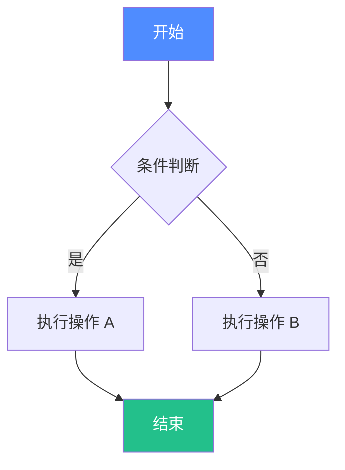

### 2. 时序图 Sequence Diagram

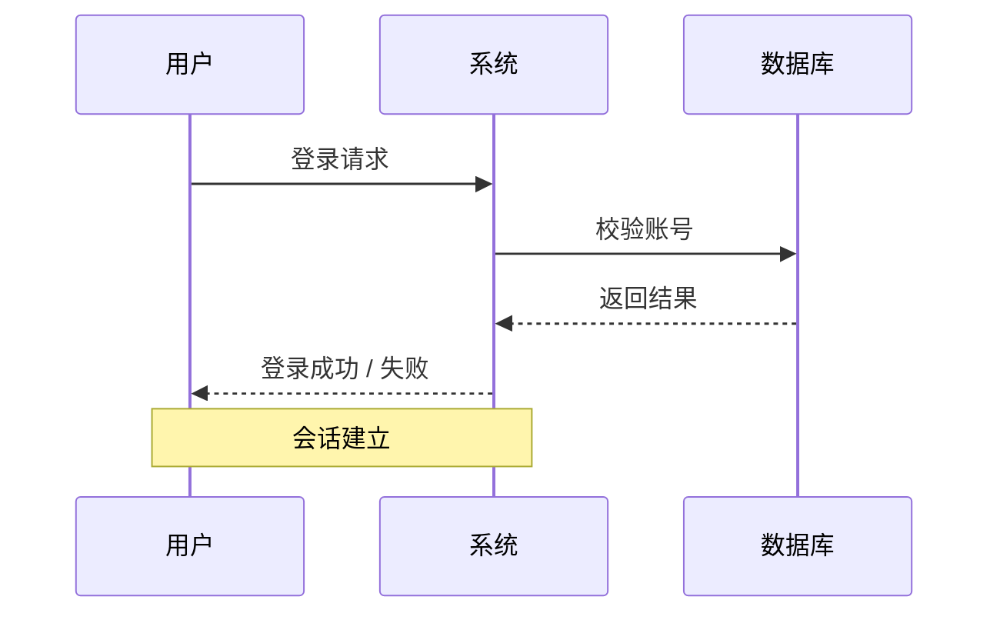

### 3. 类图 Class Diagram

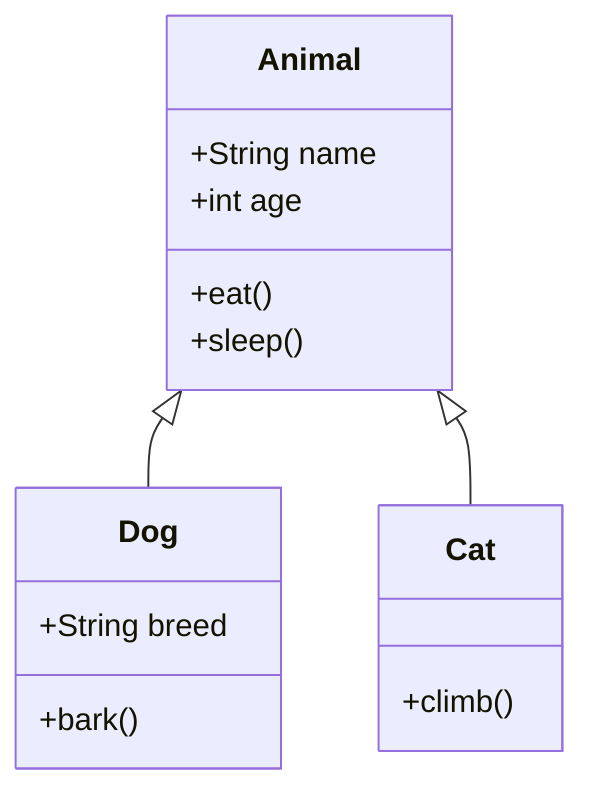

### 4. 状态图 State Diagram

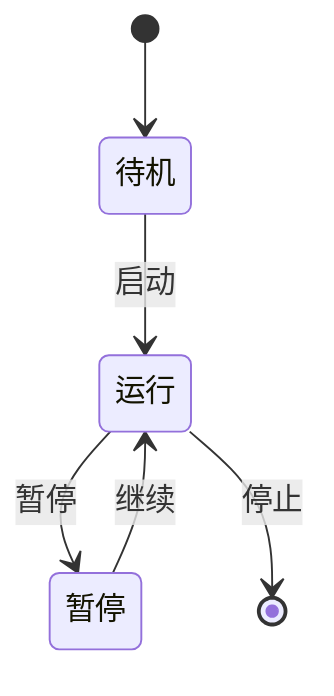

### 5. 甘特图 Gantt Chart

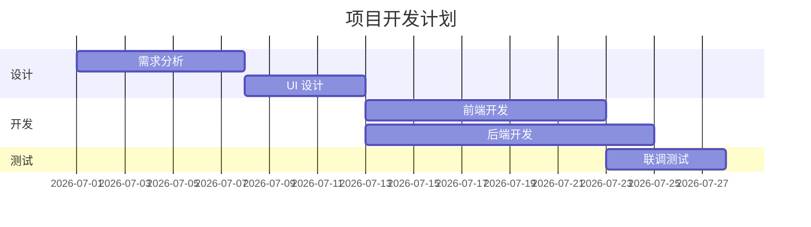

### 6. 饼图 Pie Chart

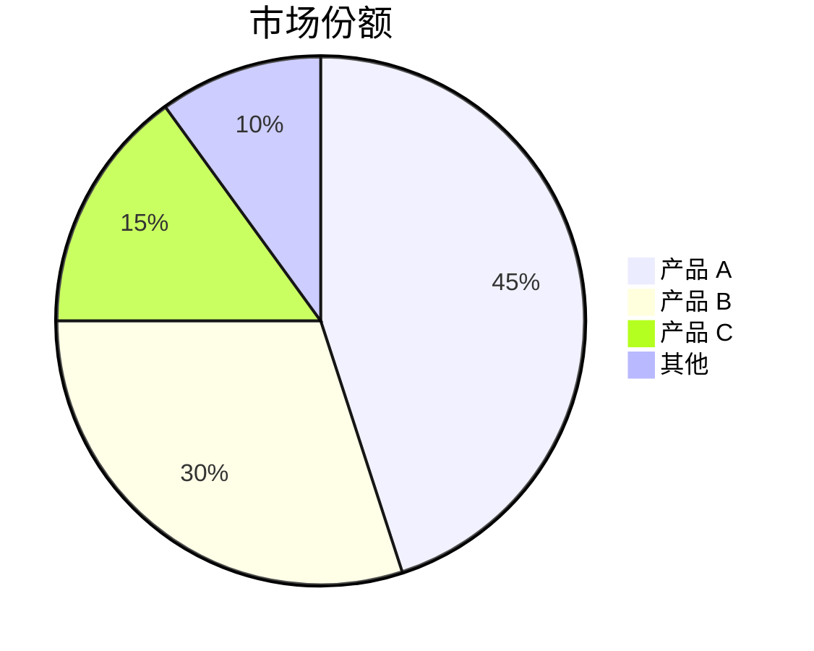

### 7. 思维导图 Mindmap

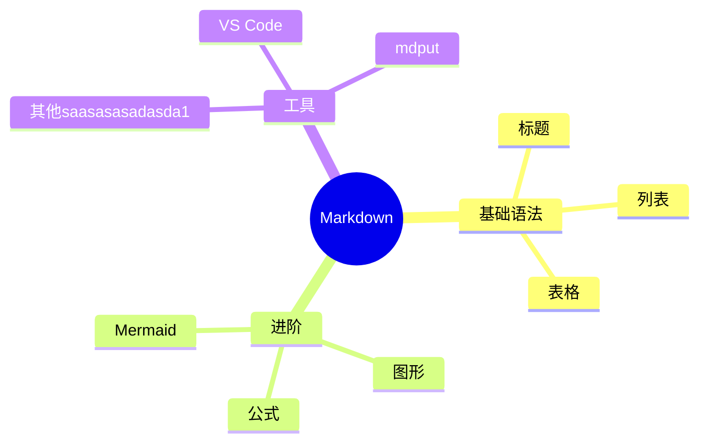

### 8. 实体关系图 ER Diagram

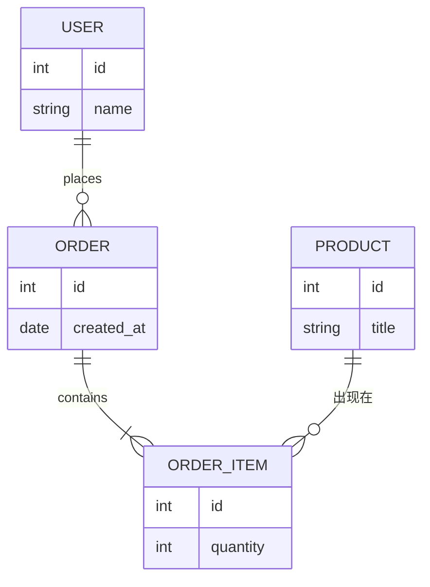

---

## 二十三、扩展图表（Mermaid 进阶）

### 9. 用户旅程图 Journey

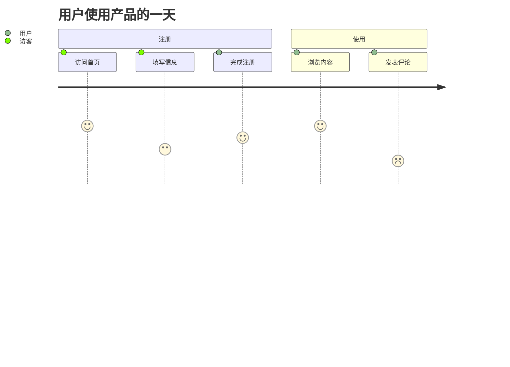

### 10. Git 提交图 Git Graph

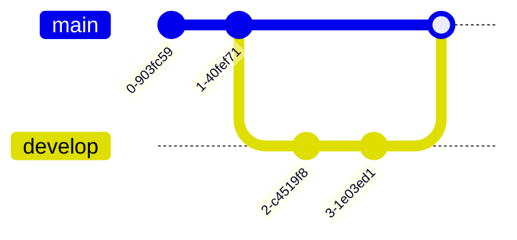

### 11. 时间线 Timeline

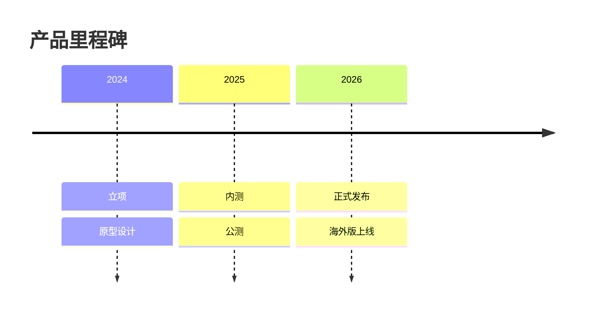

### 12. 四象限图 Quadrant Chart

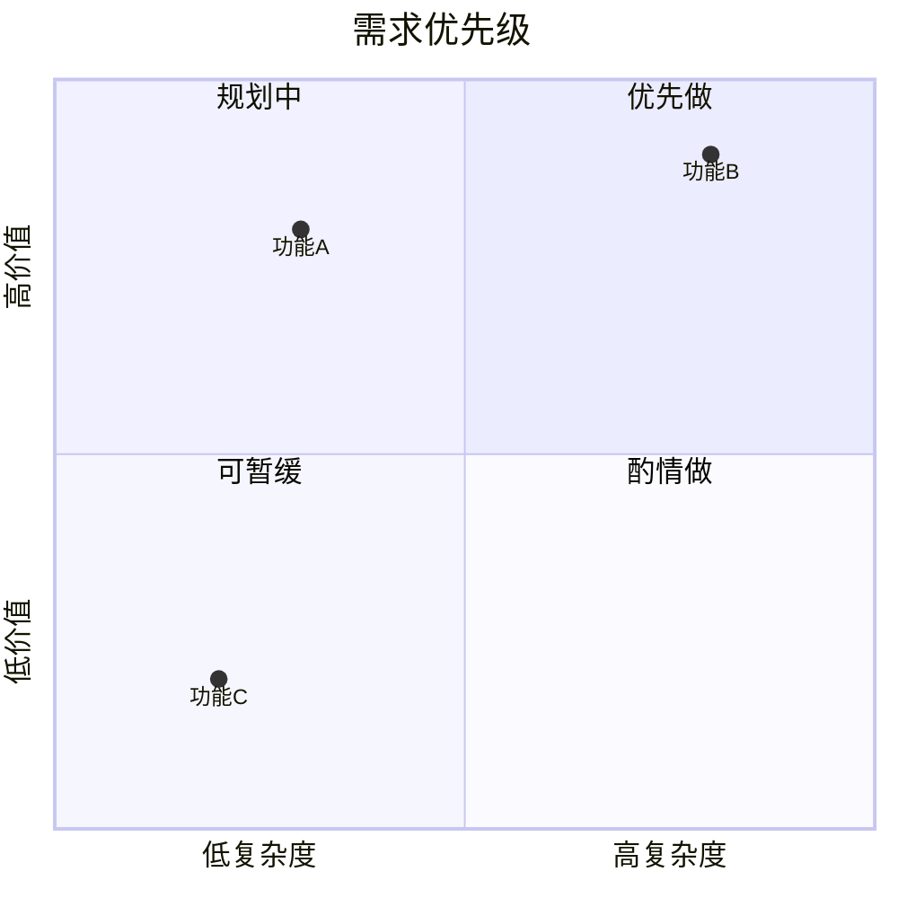


## 小结

以上几乎涵盖了 Markdown 的全部常见与进阶语法：

- **基础**：标题、强调、列表、引用、代码、链接、图片、表格、分割线、脚注、任务列表、定义列表
- **扩展块**：GitHub 提示块、折叠内容、注释、转义、Emoji、内嵌 HTML、锚点、YAML Front Matter
- **数学**：行内与块级 LaTeX 公式、对齐公式、化学方程式
- **图形**：ASCII 图、内联 SVG、占位图
- **图表**：Mermaid 流程图、时序图、类图、状态图、甘特图、饼图、思维导图、ER 图、旅程图、Git 图、时间线、四象限图、桑基图

不同的渲染器对扩展语法（如 `==高亮==`、脚注、Mermaid、公式、提示块）支持程度不一，建议在实际使用的平台中预览确认。

---

*文档版本：2.0　生成时间：2026-07-21*

